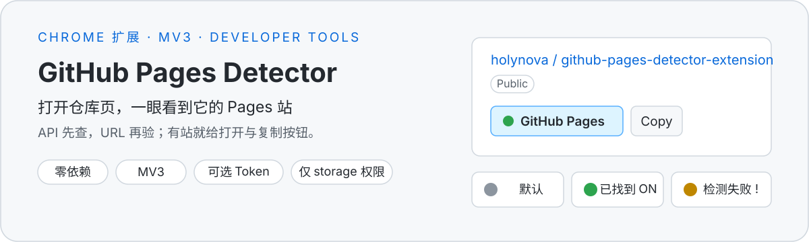
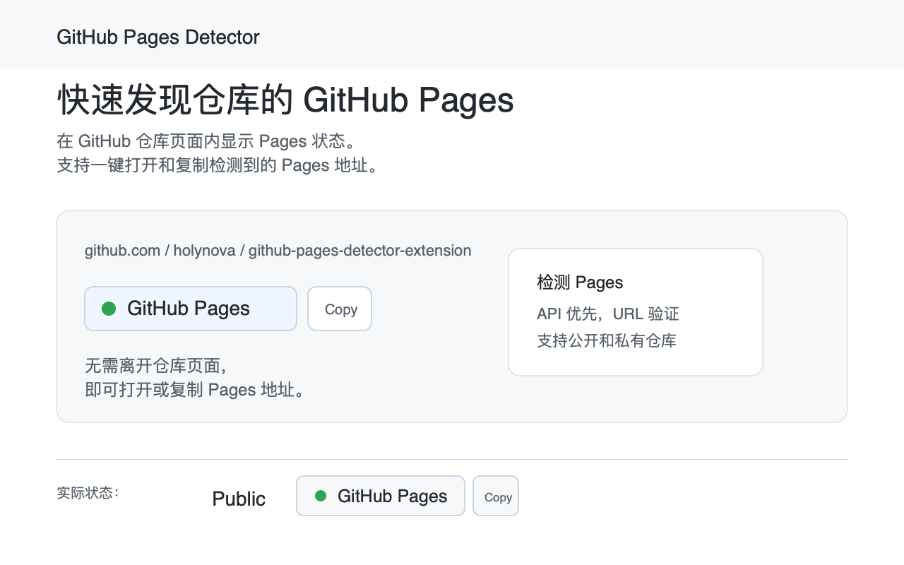

<p align="right"><a href="README.md">中文</a></p>

<p align="center">
  
</p>

<p align="center">
  <a href="https://github.com/holynova/github-pages-detector-extension">GitHub Repository</a>
</p>

GitHub Pages Detector is a Chrome extension (Manifest V3, zero dependencies): open any GitHub repository page and it shows right in the header whether that repo has a GitHub Pages site. If it does, you get an "Open" button and a "Copy" button for the Pages URL — no leaving the repo page, no guessing whether `owner.github.io/repo` resolves.

## Screenshots

<p align="center">
  
</p>

## Features

- **Inline status**: the repo header shows one of four states — Checking Pages, GitHub Pages (with Open and Copy buttons), No GitHub Pages, or Pages check failed.
- **Two-step detection**: it queries the GitHub Pages API first (`GET /repos/{owner}/{repo}/pages`); if the API is inconclusive, it fetches the inferred Pages URL and rules out GitHub's 404 page by its marker text.
- **Toolbar icon in sync**: green icon with an `ON` badge when a site is found, a `!` badge and yellow warning icon on failure; hovering shows the Pages URL.
- **Private repos (optional token)**: add a fine-grained GitHub token (repository metadata read-only) in the options page for accurate API checks on private repos; public repos need no token.
- **SPA-aware**: watches pushState/popstate and DOM mutations to re-check as you navigate between repos; results are cached per repo.

## Install

Chrome Web Store listing materials are ready in `chrome-store/` (EN + zh-CN copy, screenshots, promo art, submission checklist); for now, install in developer mode:

1. Open `chrome://extensions/` and turn on "Developer mode" in the top right.
2. Click "Load unpacked" and select the repository root (or unzip `dist/github-pages-detector-extension-0.1.0.zip` and select the extracted folder).
3. Open any GitHub repository page — the detection status appears in the header.

Validation script (zero dependencies, run directly with Node):

```bash
npm run validate   # node --check on the three source files
```

## Privacy & Permissions

- Only the `storage` permission (for the optional token) plus three host permissions: `github.com`, `api.github.com`, and `*.github.io`.
- The token stays in local browser sync storage and is sent nowhere except the GitHub API; no browsing data is collected or uploaded.
- See the privacy policy in `privacy.html` at the repository root.

## Tech

- Manifest V3, vanilla JavaScript, zero dependencies, no build step: `src/background.js` (service worker, API + URL dual detection), `src/content.js` (injects status and buttons into repo pages), `src/options.js` (token settings).
- Icons in three states (default / found / warning) at 4 sizes in `icons/`; the landing page `index.html` and privacy page `privacy.html` are at the repository root.

```
manifest.json          MV3 manifest: storage permission + 3 host permissions
src/background.js      Detection logic: GitHub Pages API → inferred URL fetch → toolbar state
src/content.js         Content script: parse repo path, inject status, Open/Copy buttons, SPA listening
src/options.html/js    Options page: optional GitHub token settings
icons/                 Three-state icons (default / active / warning) × 16/32/48/128
chrome-store/          Store listing materials: EN + zh-CN copy, screenshots, promo art, checklist
dist/                  Packaged build: github-pages-detector-extension-0.1.0.zip
```
