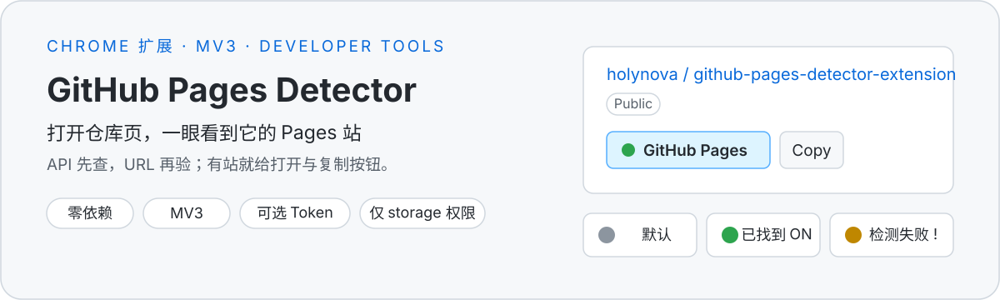
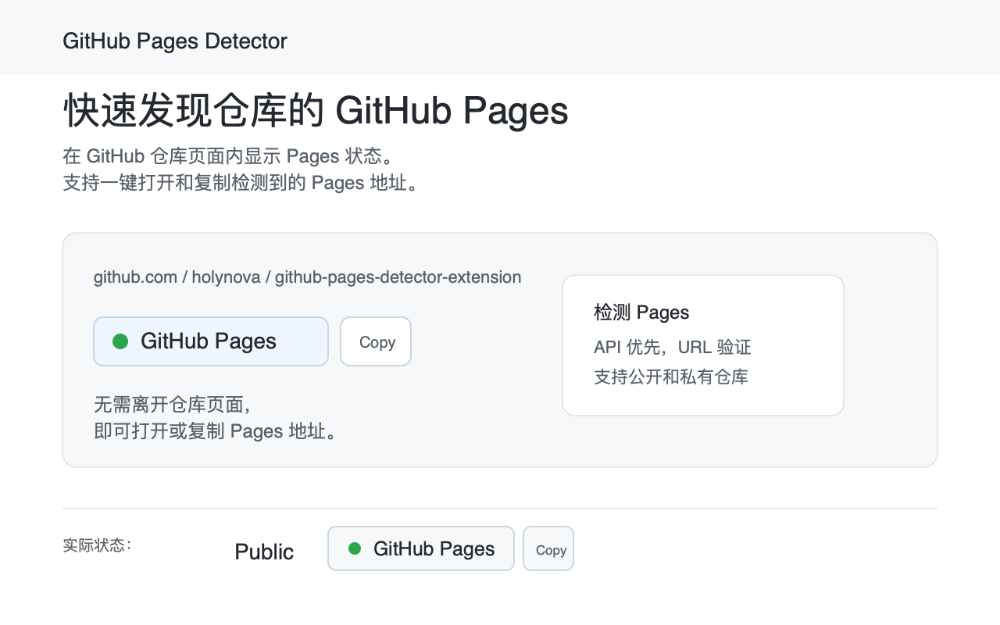

<p align="right"><a href="README.en.md">English</a></p>

<p align="center">
  
</p>

<p align="center">
  <a href="https://github.com/holynova/github-pages-detector-extension">GitHub 仓库</a>
</p>

GitHub Pages Detector 是一款 Chrome 扩展（Manifest V3，零依赖）：打开任意 GitHub 仓库页，它会在页眉直接显示该仓库有没有 GitHub Pages 站点。有站就给「GitHub Pages」打开按钮和「Copy」复制按钮，不用离开仓库页、不用猜 `owner.github.io/repo` 通不通。

## 截图

<p align="center">
  
</p>

## 功能

- **页内状态**：仓库页眉实时显示四种状态——Checking Pages（检测中）、GitHub Pages（已找到，带打开与复制按钮）、No GitHub Pages（无站点）、Pages check failed（检测失败）。
- **双重检测**：先调 GitHub Pages API（`GET /repos/{owner}/{repo}/pages`）；API 未确认时再实测推断出的 Pages 地址，并用 GitHub 404 特征文案排除假 200。
- **工具栏图标同步**：找到站点时图标变绿并显示 `ON` 角标；检测失败显示 `!` 角标与黄色警告图标；悬停标题直接给出 Pages 地址。
- **私有仓库支持（可选 Token）**：在扩展选项页填一个细粒度 GitHub Token（仅需仓库元数据读取权限），即可对私有仓库做准确的 API 检测；公开仓库不需要 Token。
- **SPA 导航跟随**：监听 pushState / popstate 与 DOM 变化，在 GitHub 单页内切换仓库时自动重新检测；同仓库结果有缓存，不重复请求。

## 安装

Chrome 网上应用店上架材料已备好（`chrome-store/`：中英双语介绍、截图、宣传图与提交清单），目前请用开发者模式安装：

1. 打开 `chrome://extensions/`，开启右上角「开发者模式」。
2. 点「加载已解压的扩展程序」，选择本仓库根目录（或解压 `dist/github-pages-detector-extension-0.1.0.zip` 后选择解压目录）。
3. 打开任意 GitHub 仓库页，页眉即出现检测状态。

校验脚本（零依赖，Node 直接跑）：

```bash
npm run validate   # node --check 三个源文件
```

## 隐私与权限

- 仅申请 `storage` 权限（存可选 Token）与三个 host 权限：`github.com`、`api.github.com`、`*.github.io`。
- Token 只存在本地浏览器同步存储里，不发送给除 GitHub API 之外的任何地方；不收集、不上传任何浏览数据。
- 隐私政策见仓库根目录 `privacy.html`。

## 技术

- Manifest V3，纯原生 JavaScript，零依赖、零构建：`src/background.js`（Service Worker，API + URL 双重检测）、`src/content.js`（仓库页注入状态与按钮）、`src/options.js`（Token 设置）。
- 图标三态（默认 / 已找到 / 警告）各 4 尺寸在 `icons/`；介绍页 `index.html`、隐私页 `privacy.html` 在仓库根目录。

```
manifest.json          MV3 清单：storage 权限 + 3 个 host 权限
src/background.js      检测逻辑：GitHub Pages API → 推断 URL 实测 → 工具栏状态
src/content.js         内容脚本：解析仓库路径、注入状态、打开/复制按钮、SPA 监听
src/options.html/js    选项页：可选 GitHub Token 设置
icons/                 三态图标（default / active / warning）× 16/32/48/128
chrome-store/          应用店上架材料：中英介绍、截图、宣传图、提交清单
dist/                  打包产物：github-pages-detector-extension-0.1.0.zip
```
